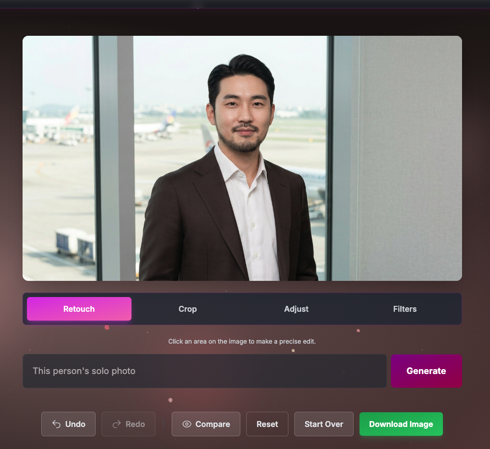
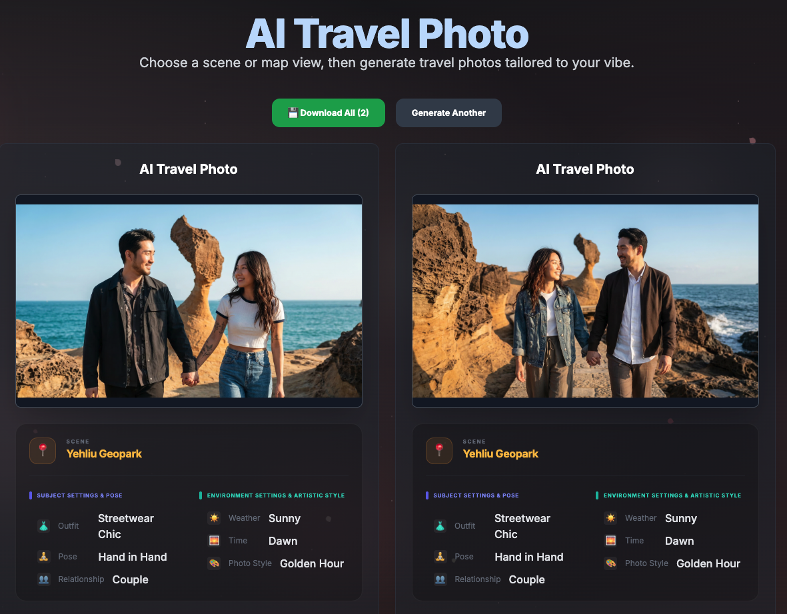
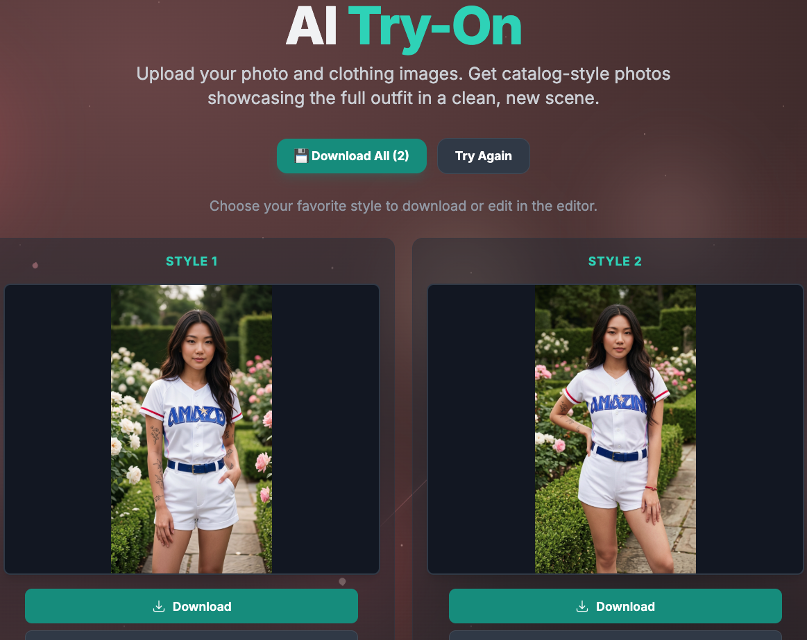

# BloomRender

[English](./README.md) | [繁體中文](./README.zh-TW.md)

[](https://github.com/poirotw66/bloom-render/actions/workflows/ci.yml)
[](./LICENSE)
[](https://www.bloss0m.com/bloom-render/)

**BloomRender — Let your ideas bloom.**

AI-powered photo editing and generation studio on the Google Gemini API: retouch, filters, ID photos, portraits, travel shots, themed shoots, couple/group photos, and virtual try-on.

**Live demo:** [https://www.bloss0m.com/bloom-render/](https://www.bloss0m.com/bloom-render/)

### Preview

| Text to image                                        | AI ID photo                                  | Image editor                               |
| ---------------------------------------------------- | -------------------------------------------- | ------------------------------------------ |
|  |  |  |

| AI travel photo                                       | AI virtual try-on                             |
| ----------------------------------------------------- | --------------------------------------------- |
|  |  |

---

## Features

Start-screen tabs, in order: **Upload** → **Text to image** → **Photography service** → **ID photo** → **Portrait** → **Travel** → **Themed** → **Couple / group** → **Try-on**.

- **Upload** — Drop or pick a file and open the editor.
- **Text to image** — Describe a scene, pick aspect ratio (1:1, 4:3, 3:4, 16:9, 9:16) and count (1–4); download singles or a ZIP, or send one result to the editor.
- **Image editor** — Point-and-prompt retouch, style filters, global adjustments, free/ID-spec crop; undo, redo, compare, reset, download.
- **AI ID photo** — Document type, retouch level, output size, clothing (text or reference); single and batch ZIP download.
- **AI portrait** — Professional headshots from a portrait upload.
- **AI travel photo** — World / Taiwan map scene picks with weather, time, outfit, and framing; solo, couple, or group.
- **AI themed shoot** — Theme, size, and aspect ratio from a portrait.
- **AI couple / group** — 2 portraits (couple) or 3–6 (group) into one composite.
- **AI virtual try-on** — One person photo + 1–5 garment photos; multi-style results with single or bulk download.
- **Settings** — Gemini API key, model, language, theme (browser-only).
- **i18n** — English and Traditional Chinese.
- **Themes** — Bloom, Night, New Year.
- **History** — Browse, filter, and batch-download past generations.

---

## Quick start

Requirements: **Node.js 20+**, npm (use `npm ci` when installing from the lockfile).

1. **Install**

   ```bash
   npm ci
   ```

2. **API key (BYOK)** — Open **Settings** in the app and paste a [Google AI Studio](https://aistudio.google.com/app/apikey) Gemini key. The key stays in the browser (`localStorage`) only. It is never committed, never read from env files, and never baked into the production bundle. See [`.env.example`](./.env.example).

3. **Run**

   ```bash
   npm run dev
   ```

   Open the URL shown in the terminal (default [http://localhost:3002](http://localhost:3002)).

4. **Optional static assets**
   - Maps for Travel: `public/images/world-map.webp`, `public/images/taiwan-map.webp` (see `public/images/README.md`). Convert PNG → WebP with `node scripts/convert-public-images-to-webp.mjs` if needed.
   - Scene reference images under `public/images/scenes/` are optional; follow [docs/SCENE_IMAGES_SOURCES.md](docs/SCENE_IMAGES_SOURCES.md). Text-only generation still works without them.

---

## API keys

| Context              | How                                                                                                                     |
| -------------------- | ----------------------------------------------------------------------------------------------------------------------- |
| **Settings (BYOK)**  | Gear → paste Gemini API key. Stored in `localStorage` for this origin only. Never bundled.                              |
| **Get a key**        | [Google AI Studio](https://aistudio.google.com/app/apikey)                                                              |
| **Env / CI / Pages** | No API key env var is used. Do not set `GEMINI_API_KEY` (or similar) for builds — nothing injects keys into the client. |

Do not commit `.env` / `.env.local` or paste keys into issues. Set quotas and billing limits on the provider side.

---

## Tech stack

- **Runtime** — React 19, TypeScript, Vite 6
- **Routing** — React Router 7
- **Editing** — react-image-crop
- **AI** — [@google/genai](https://www.npmjs.com/package/@google/genai) (Gemini API)
- **Batch download** — JSZip
- **Styles** — Tailwind CSS 4 via `@tailwindcss/vite` (build-time; not CDN) + custom CSS
- **Tooling** — ESLint, Prettier, Vitest, Husky, lint-staged

---

## Scripts

| Command                           | Description                                                |
| --------------------------------- | ---------------------------------------------------------- |
| `npm run dev`                     | Dev server (port 3002)                                     |
| `npm run build`                   | Production build to `dist/` (+ `404.html` for SPA hosting) |
| `npm run preview`                 | Preview the production build                               |
| `npm run typecheck`               | `tsc --noEmit`                                             |
| `npm run lint`                    | ESLint                                                     |
| `npm test`                        | Vitest                                                     |
| `npm run format` / `format:check` | Prettier write / check                                     |

---

## Deploy

- Ship the `dist/` folder to any static host.
- **GitHub Pages**: set `GITHUB_PAGES=true` so `base` is `/bloom-render/`. See [.github/workflows/deploy.yml](.github/workflows/deploy.yml) (runs on `main` only, after the CI quality gate).

---

## Docs

- **[User manual](docs/BLOOMRENDER_MANUAL.md)** (Traditional Chinese) — walkthroughs for generate, ID photo, portrait, travel, try-on, and the editor.

---

## Contributing

See [CONTRIBUTING.md](./CONTRIBUTING.md).

---

## License

[MIT](./LICENSE) © 2026 poirotw66
