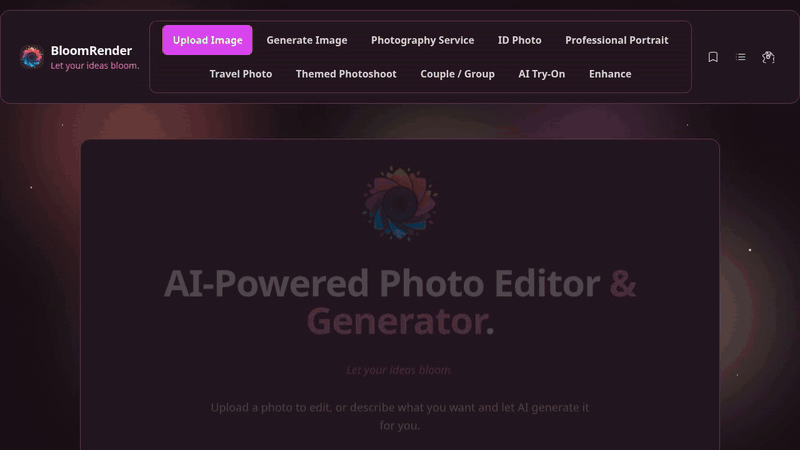
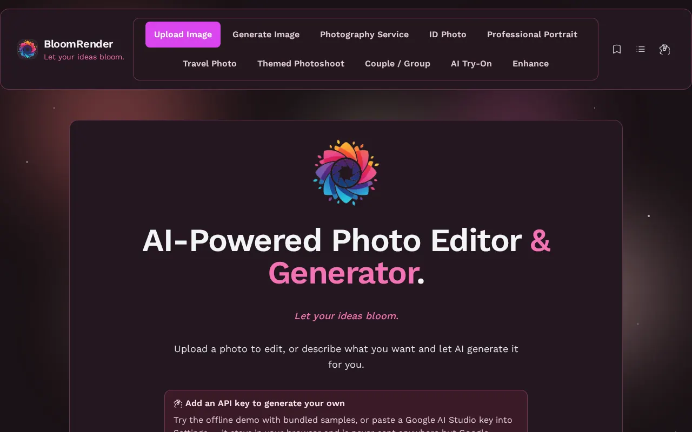
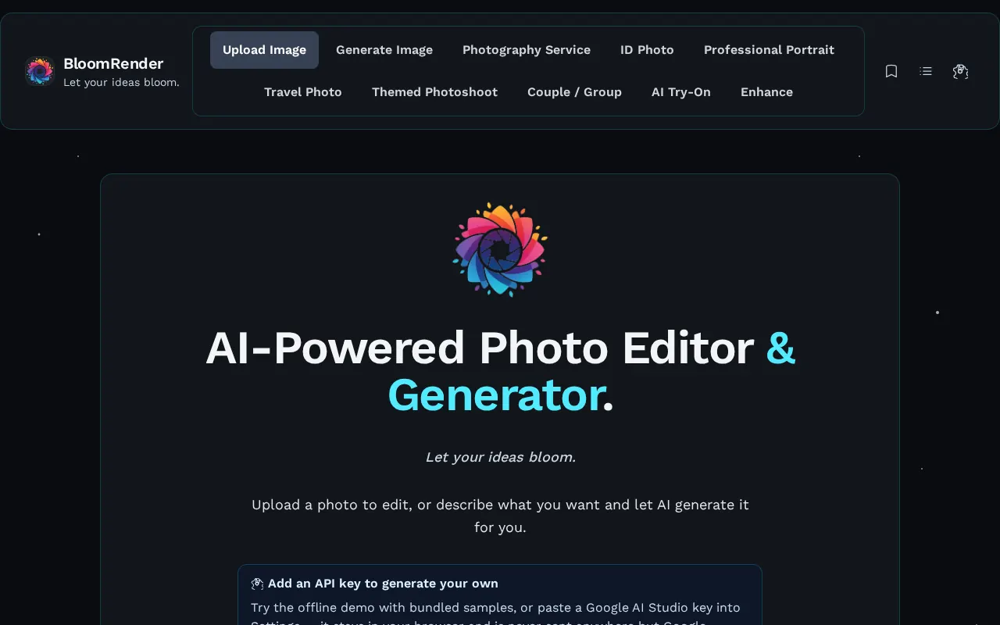
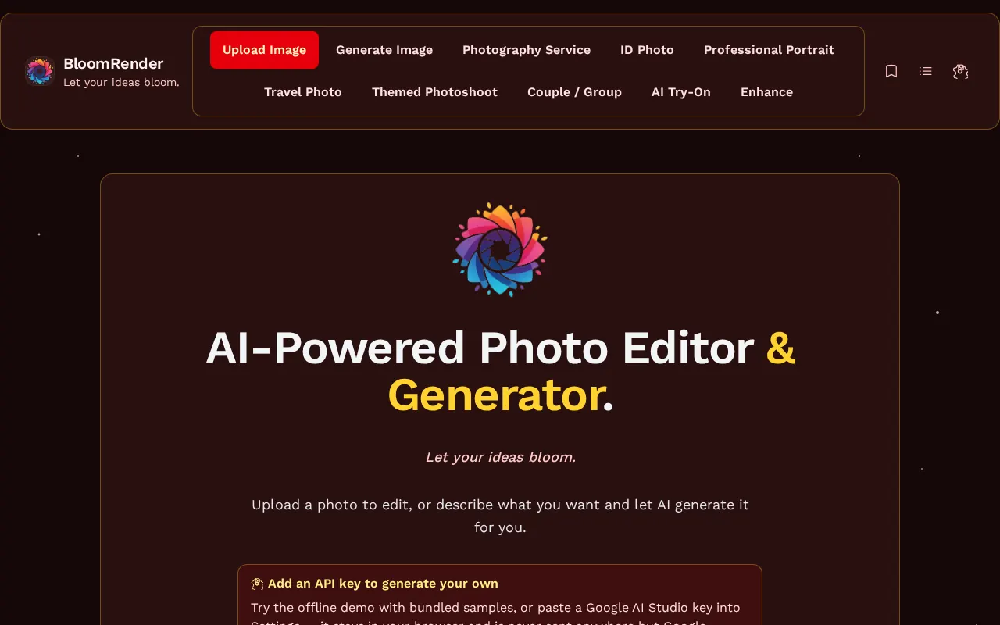
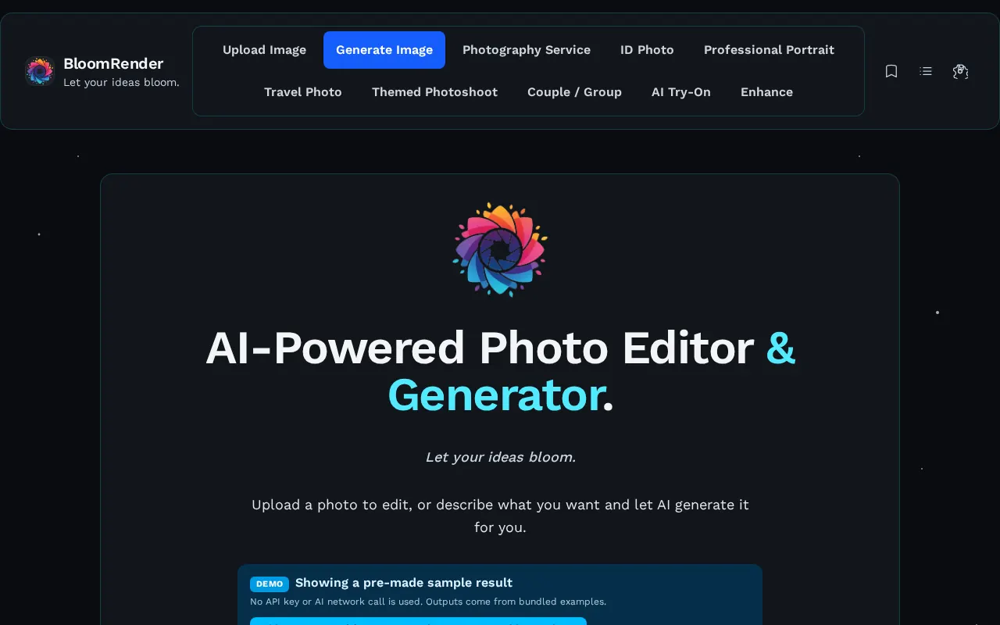
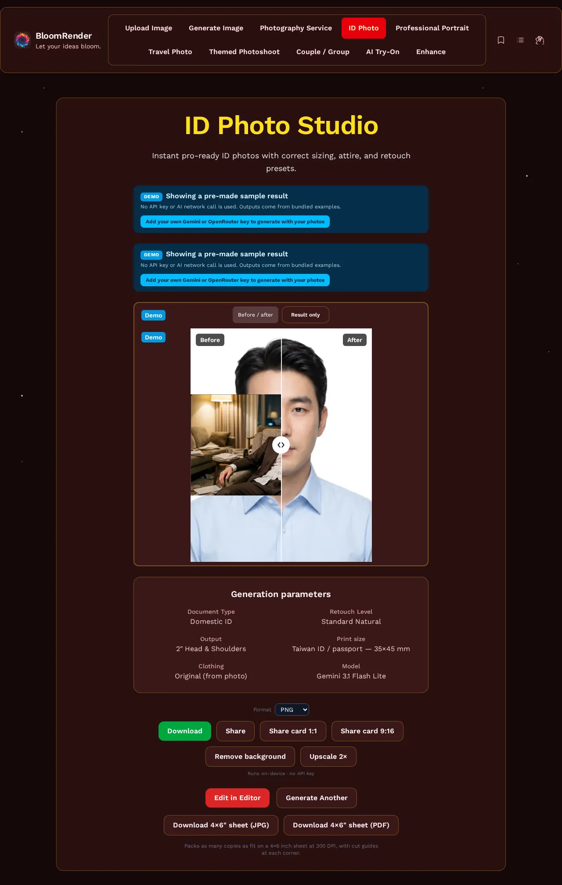
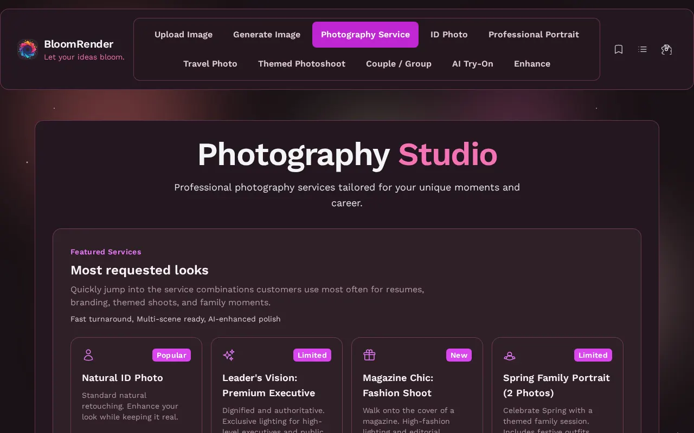
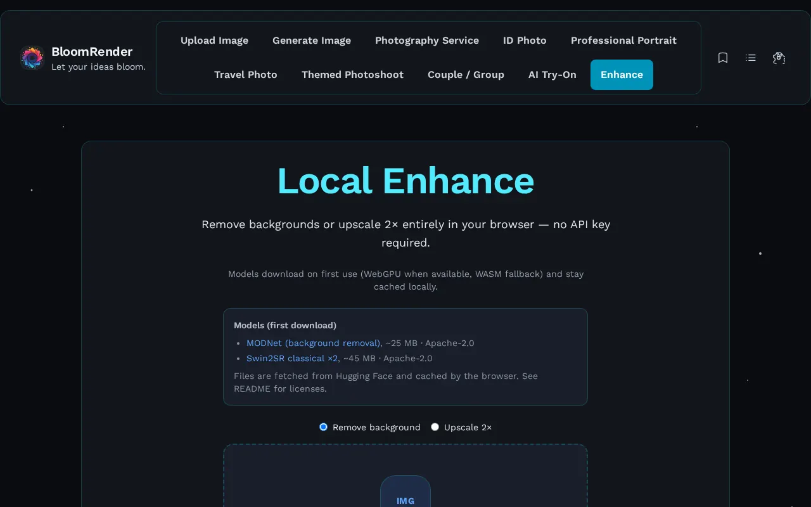
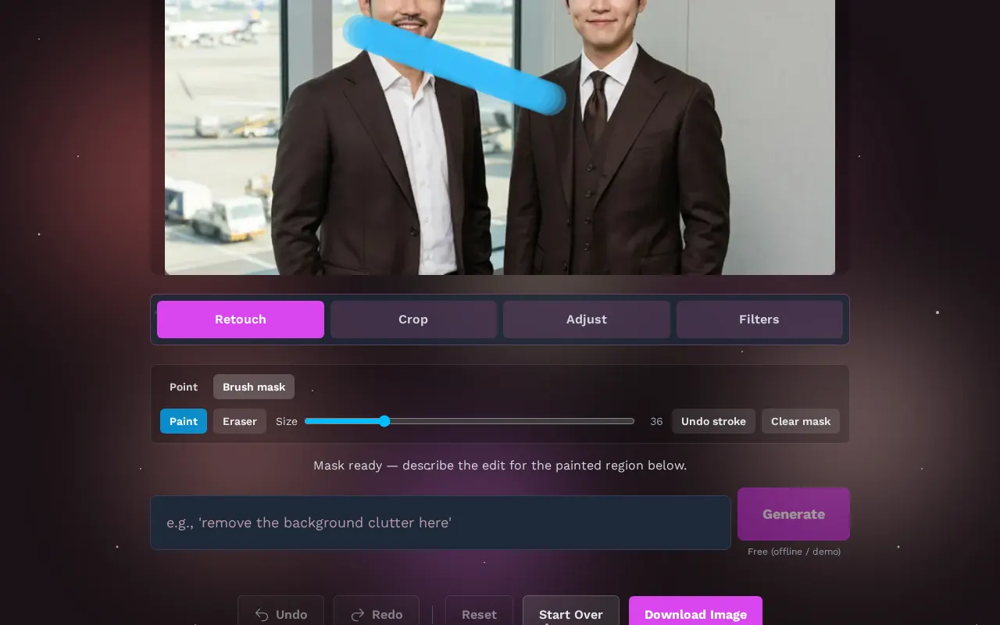
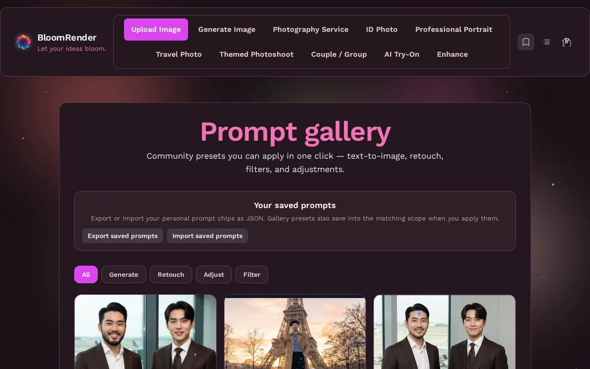

# BloomRender

[English](./README.md) | [繁體中文](./README.zh-TW.md)

**AI photo studio in your browser — BYO Gemini / OpenAI / OpenRouter key, or try the offline demo with no key.**

[](https://github.com/poirotw66/bloom-render/actions/workflows/ci.yml)
[](./LICENSE)
[](https://www.bloss0m.com/bloom-render/)

**[Live demo → https://www.bloss0m.com/bloom-render/](https://www.bloss0m.com/bloom-render/)** · Tap **Try demo** for bundled samples (no API key, no AI network call). Keys default to this tab’s `sessionStorage` only; optional **Remember key on this device** uses `localStorage` (see Privacy).



### Themes · 繁花 Bloom · 深夜 Night · 新年 New Year

| Bloom                                             | Night                                             | New Year                                               |
| ------------------------------------------------- | ------------------------------------------------- | ------------------------------------------------------ |
|  |  |  |

### Features at a glance

| Generate                                       | ID photo + 4×6″ print sheet                                       | Photography Studio                                                  |
| ---------------------------------------------- | ----------------------------------------------------------------- | ------------------------------------------------------------------- |
|  |  |  |

| Local Enhance                                | Editor mask brush                                    | Prompt gallery                                             |
| -------------------------------------------- | ---------------------------------------------------- | ---------------------------------------------------------- |
|  |  |  |

---

## Features

Start tabs: **Upload** → **Generate** → **Photography Studio** → **ID photo** → **Portrait** → **Travel** → **Themed** → **Couple / group** → **Try-on** → **Enhance**.

- **Upload / editor** — Point-and-prompt retouch, **brush mask**, filters, adjustments, free/ID crop; undo, redo, compare, download.
- **Text to image** — Prompt, aspect ratio, 1–4 images; combine uploaded inspiration with every selected basket reference. History export and replay retain the input images.
- **Photography Studio** — Hub into ID, portrait, themed, couple/group, and promo looks (no prices).
- **AI ID photo** — Specs, retouch, clothing; before/after; **4×6″ print sheet** (JPG/PDF); single + batch ZIP.
- **Portrait / travel / themed / couple·group / try-on** — Dedicated generators with demo samples.
- **Local Enhance** — On-device background removal & 2× upscale (no API key).
- **Prompt gallery** — Community presets; apply into generate / retouch / adjust / filter.
- **One-tap 玩法** — 79 viral style templates (figurine, era, Taiwan, toys, art, retro, social, costume, holiday, pet); favorites/recent, filter chips, remix (`/r#…`).
- **Multi-style collage** — Pick 4–6 玩法 styles from one photo and download a labeled collage (`/style-collage`).
- **Multi-person synthesis** — Upload 2–4 portraits into a shared-frame viral style (`/multi-person`).
- **History · share · compare** — Browse past runs; share cards; before/after slider.
- **Agent material tools (MCP)** — Read-only catalog browsing, bilingual keyword search, reference lookup and prompt/recipe composition over local stdio. See [MCP setup](mcp/README.md); no browser photos, keys or provider calls.
- **Material basket** — Select built-in references across tool pages and reloads, then use them in try-on or generation. Stores catalog IDs only. Adding to an existing try-on preserves your person photo, clothing, settings and custom prompt; replacing another reference requires confirmation.
- **Try-on prompt editor** — Open **Prompt** to inspect image order, copy the automatic prompt, switch to Manual, or reset to Automatic. Manual text stays unchanged when references/settings change and survives drafts, history replay and failed-slot retries. Batch automatic preview shows image 1; manual mode uses the same text for every image.
- **Try-on references and drafts** — Original CC0 clothing, pose and lighting illustrations, plus optional uploaded pose, expression, scene and lighting references. Preserve the original background or pose; drafts keep input images in IndexedDB and can be cleared. Demo uses samples only.
- **Try-on recipes** — Share links and import/export JSON contain built-in material IDs and settings by default. Custom prompt text is shared only with explicit opt-in; uploaded images and API keys remain excluded. History replay restores saved person, clothing and other references.
- **Full history export** — ZIP backups include results, source photos, references and generation metadata. Older records may lack original inputs. Reference materials have searchable, shareable detail pages.
- **Settings** — Gemini / OpenAI / OpenRouter / Live demo; language; themes (**Bloom**, **Night**, **New Year**).
- **i18n** — English & Traditional Chinese. **PWA**-ready static build.

---

## Quick start

**Node.js 22.12+**, npm (`npm ci` from the lockfile).

```bash
npm ci
npm run dev
```

Open the URL in the terminal (default [http://localhost:3002](http://localhost:3002)).

1. Tap **Try demo** (or Settings → **Live demo (no key)**) to explore with bundled samples.
2. For real generation: Settings → **Google Gemini**, **OpenAI (direct)** or **OpenRouter (BYOK)** → paste key (default: tab-scoped `sessionStorage`; optional remember on device). Never committed or bundled. See [`.env.example`](./.env.example).

Optional Travel maps: `public/images/world-map.webp`, `public/images/taiwan-map.webp` ([public/images/README.md](public/images/README.md)). Scene refs: [docs/SCENE_IMAGES_SOURCES.md](docs/SCENE_IMAGES_SOURCES.md).

---

## Privacy / BYO key

| Context              | How                                                                                                                                                                                                                                                                                                                                                            |
| -------------------- | -------------------------------------------------------------------------------------------------------------------------------------------------------------------------------------------------------------------------------------------------------------------------------------------------------------------------------------------------------------- |
| **Settings (BYOK)**  | Gear → **Image provider**: `Google Gemini`, `OpenAI (direct)` or `OpenRouter (BYOK)`. Paste the matching key and pick a model. Default: `sessionStorage` for this tab only. Opt-in **Remember key on this device** also mirrors keys into `localStorage` (anyone with device/backup access can read them; turning it off wipes the local copy). Never bundled. |
| **Get a key**        | Gemini: [Google AI Studio](https://aistudio.google.com/app/apikey). OpenAI: [OpenAI API keys](https://platform.openai.com/api-keys). OpenRouter: [openrouter.ai/keys](https://openrouter.ai/keys).                                                                                                                                                             |
| **Env / CI / Pages** | No API key env var is used. Do not set `GEMINI_API_KEY` / `OPENROUTER_*` for builds — nothing injects keys into the client.                                                                                                                                                                                                                                    |

OpenAI connects directly to the [Images API](https://developers.openai.com/api/docs/guides/image-generation), using a separate key and model selection. The model catalog includes `gpt-image-2.6-sunburst` (default), `gpt-image-2.6-flare`, and `gpt-image-1.5`. Text-only requests use image generations; uploads and multiple references use image edits. Sunburst and Flare support the app's 1K/2K/4K choices. GPT Image 1.5 uses its nearest supported square, portrait, or landscape size; it does not promise an exact custom aspect ratio. Painted masks use the existing prompt/overlay edit path. OpenAI pricing depends on input, size and quality, so the app leaves cost unknown instead of assuming a fixed charge.

### What each provider covers

| Surface                                                                                                     | Provider                                                                  |
| ----------------------------------------------------------------------------------------------------------- | ------------------------------------------------------------------------- |
| Text-to-image, editor (retouch / filter / adjust), ID photo, portrait, travel, themed, couple/group, try-on | Selected provider (`services/imageProviders/`)                            |
| Travel **custom-scene prompt optimization** (text)                                                          | **Gemini-only** — skipped on OpenAI / OpenRouter; your raw prompt is used |
| Home-screen **model compare**                                                                               | **Gemini-only** (compares Gemini model ids)                               |
| **Local Enhance** (bg remove / 2× upscale)                                                                  | On-device — no provider key                                               |

Prefer image-capable OpenRouter models that mirror Gemini’s Nano Banana family
(`google/gemini-nano-banana-2.1`, `google/gemini-3.1-flash-lite-image`,
`google/gemini-3.1-flash-image`). Do not commit `.env` / `.env.local` or paste keys into issues.

---

## Tech stack

- **Runtime** — React 19, TypeScript, Vite 6
- **Routing** — React Router 7
- **Editing** — react-image-crop
- **AI** — [@google/genai](https://www.npmjs.com/package/@google/genai) (Gemini) + direct OpenAI and OpenRouter Images APIs via `services/imageProviders/`
- **On-device enhance** — [@huggingface/transformers](https://www.npmjs.com/package/@huggingface/transformers) (WebGPU + WASM)
- **Batch download** — JSZip
- **Styles** — Tailwind CSS 4 via `@tailwindcss/vite` + custom CSS
- **Tooling** — ESLint, Prettier, Vitest, Husky, lint-staged

### Client-side models (Enhance)

| Task               | Model                                                                                         | ~Size | License    |
| ------------------ | --------------------------------------------------------------------------------------------- | ----- | ---------- |
| Background removal | [Xenova/modnet](https://huggingface.co/Xenova/modnet)                                         | 25 MB | Apache-2.0 |
| 2× upscaling       | [Xenova/swin2SR-classical-sr-x2-64](https://huggingface.co/Xenova/swin2SR-classical-sr-x2-64) | 45 MB | Apache-2.0 |

---

## Architecture

Image generation goes through `services/imageProviders/`: a shared `ImageProvider` interface with Gemini, direct OpenAI, OpenRouter, and offline demo implementations. Feature modules call `runImageGeneration`. BYOK keys: `utils/credentialStorage.ts` (`sessionStorage` by default; optional `localStorage` remember). Local enhance lives in `services/localEnhance/`.

---

## Scripts

| Command                           | Description                                                |
| --------------------------------- | ---------------------------------------------------------- |
| `npm run dev`                     | Dev server (port 3002)                                     |
| `npm run build`                   | Production build to `dist/` (+ `404.html` for SPA hosting) |
| `npm run preview`                 | Preview the production build                               |
| `npm run typecheck`               | `tsc --noEmit`                                             |
| `npm run lint`                    | ESLint                                                     |
| `npm test`                        | Vitest                                                     |
| `npm run format` / `format:check` | Prettier write / check                                     |

---

## Deploy

- Ship `dist/` to any static host.
- **GitHub Pages**: `GITHUB_PAGES=true` → `base` `/bloom-render/`. See [.github/workflows/deploy.yml](.github/workflows/deploy.yml).

---

## Docs

See [docs/README.md](docs/README.md). Highlights:

- **[Showcase assets](docs/showcase/README.md)** — README screenshots & core-flow GIF (Wave K/L UI)
- **[Material MCP server](mcp/README.md)** — Connect Codex or another stdio MCP client
- **[User manual](docs/BLOOMRENDER_MANUAL.md)** (Traditional Chinese)
- **[Scene image sources](docs/SCENE_IMAGES_SOURCES.md)** / **[status](docs/SCENE_IMAGES_STATUS.md)**
- **[Type layout](docs/TYPES.md)**

---

## Contributing

See [CONTRIBUTING.md](./CONTRIBUTING.md). [Code of Conduct](./CODE_OF_CONDUCT.md). Security: [SECURITY.md](./SECURITY.md).

---

## License

[MIT](./LICENSE) © 2026 poirotw66
