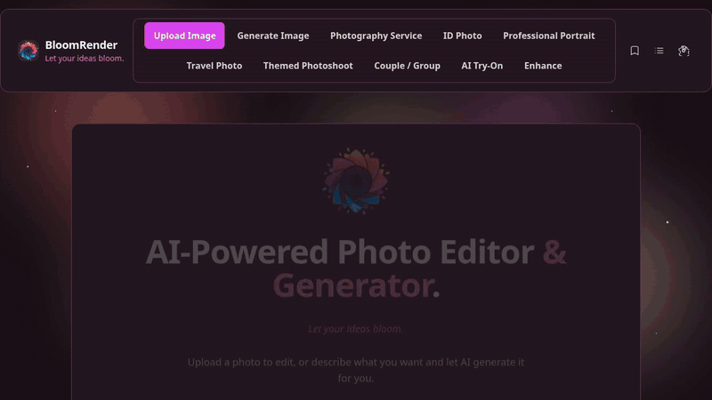
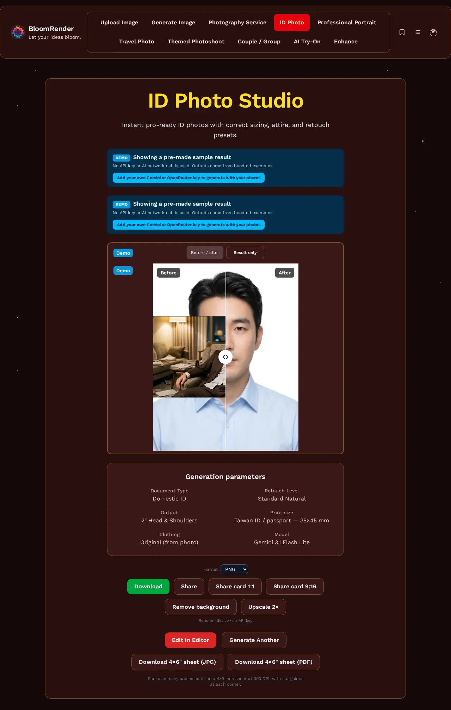
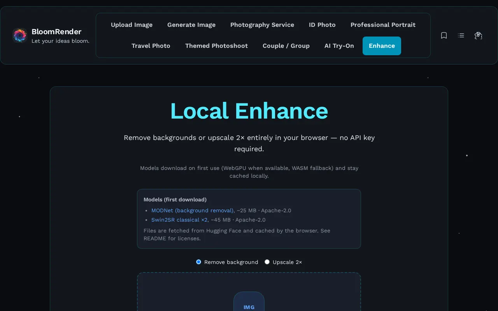
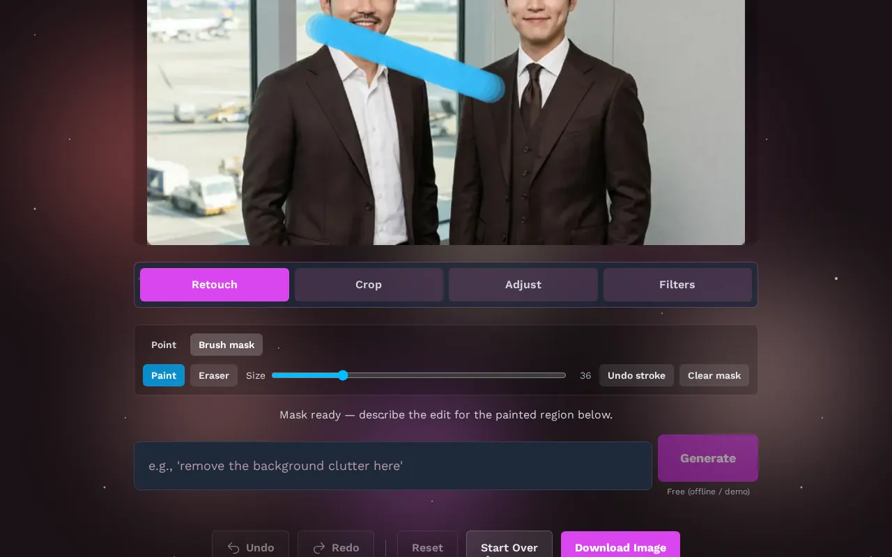
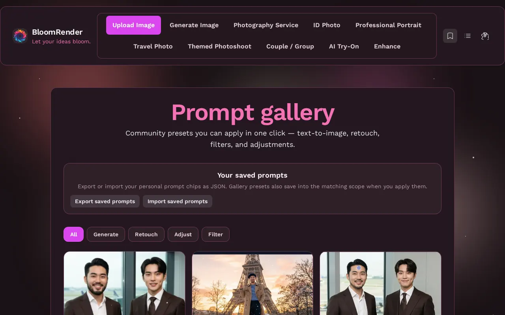

# BloomRender

[English](./README.md) | [繁體中文](./README.zh-TW.md)

**瀏覽器裡的 AI 照相館 — 自備 Gemini／OpenRouter 金鑰，或免金鑰離線 Demo。**

[](https://github.com/poirotw66/bloom-render/actions/workflows/ci.yml)
[](./LICENSE)
[](https://www.bloss0m.com/bloom-render/)

**[線上 Demo → https://www.bloss0m.com/bloom-render/](https://www.bloss0m.com/bloom-render/)** · 點 **試試 Demo** 使用內建範例（無需 API 金鑰、不連線 AI）。你貼上的金鑰只存在此分頁的 `sessionStorage`。



### 主題 · 繁花 Bloom · 深夜 Night · 新年 New Year

| 繁花 Bloom                                    | 深夜 Night                                    | 新年 New Year                                   |
| --------------------------------------------- | --------------------------------------------- | ----------------------------------------------- |
|  |  |  |

### 功能一覽

| 文字生圖                                       | 證件照 + 4×6″ 排版                                      | 照相館                                                  |
| ---------------------------------------------- | ------------------------------------------------------- | ------------------------------------------------------- |
|  |  |  |

| 本機強化                                      | 編輯器筆刷遮罩                                    | 提示詞藝廊                                             |
| --------------------------------------------- | ------------------------------------------------- | ------------------------------------------------------ |
|  |  |  |

---

## 功能概覽

分頁順序：**上傳** → **文字生圖** → **照相館** → **證件照** → **形象照** → **旅遊照** → **主題寫真** → **雙人／團體** → **虛擬試穿** → **影像強化**。

- **上傳／編輯器** — 點選修圖、**筆刷遮罩**、濾鏡、整體調整、自由／證件裁切；復原、重做、對比、下載。
- **文字生圖** — 提示詞、長寬比、1～4 張；下載或送入編輯器。
- **照相館** — 導向證件、形象、主題、雙人／團體與精選組合（**不顯示價格**）。
- **AI 證件照** — 規格、修圖、服裝；前後對比；**4×6″ 排版**（JPG／PDF）；單張與批次 ZIP。
- **形象／旅遊／主題／雙人·團體／試穿** — 各有專頁與 Demo 範例。
- **本機強化** — 瀏覽器內去背與 2× 放大（免金鑰）。
- **提示詞藝廊** — 社群預設；一鍵套用到生圖／修圖／調整／濾鏡。
- **歷史 · 分享 · 對比** — 瀏覽紀錄、分享卡片、前後滑桿。
- **設定** — Gemini／OpenRouter／線上 Demo；語系；主題（**繁花**、**深夜**、**新年**）。
- **多語系** — 英文、繁體中文。支援 **PWA** 靜態建置。

---

## 快速開始

環境：**Node.js 20+**、npm（有 lockfile 時請用 `npm ci`）。

```bash
npm ci
npm run dev
```

依終端網址開啟（預設 [http://localhost:3002](http://localhost:3002)）。

1. 點 **試試 Demo**（或設定 → **線上 Demo（免金鑰）**）用內建範例體驗。
2. 正式生成：設定 → **Google Gemini** 或 **OpenRouter（自備金鑰）** → 貼上金鑰（僅此分頁 `sessionStorage`；永不提交或打包）。見 [`.env.example`](./.env.example)。

選用旅遊地圖：`public/images/world-map.webp`、`public/images/taiwan-map.webp`（見 [public/images/README.md](public/images/README.md)）。場景參考圖：[docs/SCENE_IMAGES_SOURCES.md](docs/SCENE_IMAGES_SOURCES.md)。

---

## 隱私／自備金鑰（BYOK）

| 情境                    | 作法                                                                                                                                                      |
| ----------------------- | --------------------------------------------------------------------------------------------------------------------------------------------------------- |
| **設定（BYOK）**        | 齒輪 → **影像供應商**：`Google Gemini` 或 `OpenRouter（自備金鑰）`。貼上對應金鑰並選擇模型。金鑰存於 `sessionStorage`（僅此分頁，關閉後清除），永不打包。 |
| **取得金鑰**            | Gemini：[Google AI Studio](https://aistudio.google.com/app/apikey)。OpenRouter：[openrouter.ai/keys](https://openrouter.ai/keys)。                        |
| **環境變數／CI／Pages** | 不使用任何 API 金鑰環境變數。建置時請勿設定 `GEMINI_API_KEY`／`OPENROUTER_*` — 前端不會注入金鑰。                                                         |

### 各供應商涵蓋範圍

| 功能                                                                                     | 供應商                                             |
| ---------------------------------------------------------------------------------------- | -------------------------------------------------- |
| 文字生圖、編輯器（修圖／濾鏡／調整）、證件照、形象照、旅遊照、主題寫真、雙人／團體、試穿 | 所選供應商（`services/imageProviders/`）           |
| 旅遊照「自訂場景」**提示詞優化**（文字）                                                 | **僅 Gemini** — 選 OpenRouter 時略過，直接使用原文 |
| 首頁 **模型比較**                                                                        | **僅 Gemini**（比較 Gemini 模型 ID）               |
| **本機強化**（去背／2× 放大）                                                            | 裝置端 — 不需供應商金鑰                            |

OpenRouter 請優先選支援影像的模型。請勿提交 `.env`／`.env.local`，也勿把金鑰貼到 issue。

---

## 技術與依賴

- **Runtime**：React 19、TypeScript、Vite 6
- **路由**：React Router 7
- **編輯**：react-image-crop
- **AI**：[@google/genai](https://www.npmjs.com/package/@google/genai)（Gemini）＋ OpenRouter Images API（`services/imageProviders/`）
- **本機強化**：[@huggingface/transformers](https://www.npmjs.com/package/@huggingface/transformers)（WebGPU + WASM）
- **批次下載**：JSZip
- **樣式**：Tailwind CSS 4（`@tailwindcss/vite`）＋自訂 CSS
- **開發**：ESLint、Prettier、Vitest、Husky、lint-staged

### 用戶端模型（影像強化）

| 任務     | 模型                                                                                          | 約大小 | 授權       |
| -------- | --------------------------------------------------------------------------------------------- | ------ | ---------- |
| 去除背景 | [Xenova/modnet](https://huggingface.co/Xenova/modnet)                                         | 25 MB  | Apache-2.0 |
| 放大 2×  | [Xenova/swin2SR-classical-sr-x2-64](https://huggingface.co/Xenova/swin2SR-classical-sr-x2-64) | 45 MB  | Apache-2.0 |

---

## 架構

影像生成統一走 `services/imageProviders/`（Gemini／OpenRouter／離線 Demo）。BYOK 金鑰只存在 `sessionStorage`（`utils/credentialStorage.ts`）。本機強化在 `services/localEnhance/`。

---

## 可用指令

| 指令                              | 說明                                     |
| --------------------------------- | ---------------------------------------- |
| `npm run dev`                     | 開發伺服器（port 3002）                  |
| `npm run build`                   | 建置至 `dist/`，並產生 SPA 用 `404.html` |
| `npm run preview`                 | 預覽建置結果                             |
| `npm run typecheck`               | `tsc --noEmit`                           |
| `npm run lint`                    | ESLint                                   |
| `npm test`                        | Vitest                                   |
| `npm run format` / `format:check` | Prettier 寫入／檢查                      |

---

## 部署

- 將 `dist/` 部署至任何靜態託管即可。
- **GitHub Pages**：`GITHUB_PAGES=true` → `base` 為 `/bloom-render/`。見 [.github/workflows/deploy.yml](.github/workflows/deploy.yml)。

---

## 文件

完整索引見 [docs/README.md](docs/README.md)。重點：

- **[Showcase 素材](docs/showcase/README.md)** — README 截圖與核心流程 GIF（Wave K/L UI）
- **[BloomRender 操作手冊](docs/BLOOMRENDER_MANUAL.md)**
- **[場景圖來源](docs/SCENE_IMAGES_SOURCES.md)**／**[狀態表](docs/SCENE_IMAGES_STATUS.md)**
- **[型別配置](docs/TYPES.md)**

---

## 貢獻

見 [CONTRIBUTING.md](./CONTRIBUTING.md)。行為準則：[CODE_OF_CONDUCT.md](./CODE_OF_CONDUCT.md)。安全性：[SECURITY.md](./SECURITY.md)。

---

## 授權

[MIT](./LICENSE) © 2026 poirotw66
